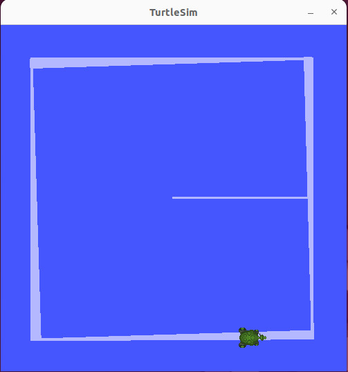
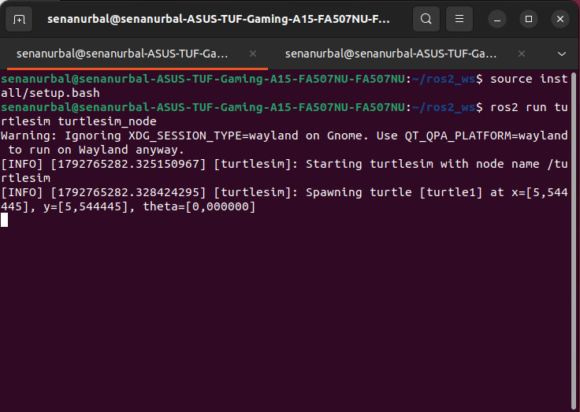
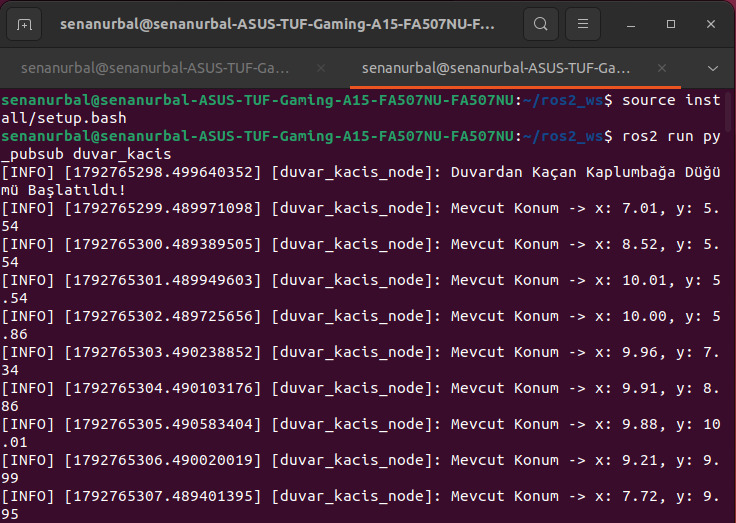
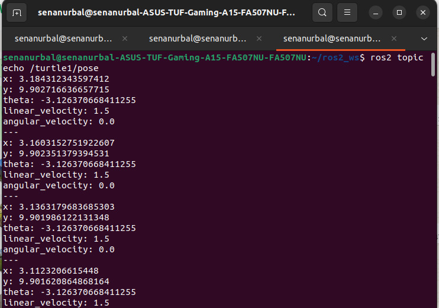
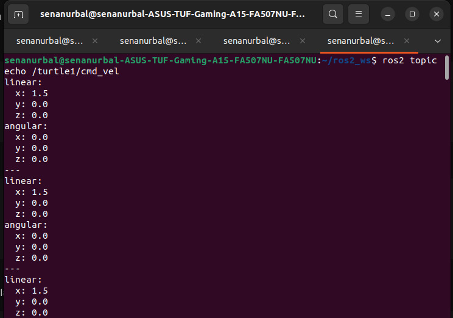

# ROS 2 Duvardan Kaçan Kaplumbağa Paketi (`turtle_duvar_py`)

Bu proje, ROS 2 kullanılarak geliştirilmiş, TurtleSim'deki kaplumbağanın konumunu dinleyen ve ekranın kenarlarına yaklaştığında dönerek yön değiştirmesini sağlayan bir ROS 2 Python paketidir. Tek bir düğüm hem abone (subscriber) hem yayıncı (publisher) olarak çalışır.

---

## 📂 Proje Yapısı

- **`duvar_kacis_node` (Abone + Yayıncı Düğüm):** `/turtle1/pose` topiğini dinleyerek kaplumbağanın `x`, `y` ve `theta` değerlerini alır, ardından `/turtle1/cmd_vel` topiğine `Twist` mesajı yayınlayarak kaplumbağayı sürer.

- **Sınır Kontrolü:** `x` veya `y` değeri sınırların dışındaysa **ve** kaplumbağa duvara doğru bakıyorsa durup döner. Duvardan uzağa bakınca tekrar ileri gider.

- **Log Mekanizması:** 1 saniyelik bir zamanlayıcı (timer) ile mevcut konum `get_logger().info()` kullanılarak ekrana yazdırılır.

- **Parametre Desteği (Bonus):** Hız ve sınır değerleri dışarıdan değiştirilebilir:

| Parametre | Varsayılan | Açıklama |
|-----------|-----------|----------|
| `linear_speed` | `1.5` | İleri hız |
| `angular_speed` | `2.0` | Dönüş hızı |
| `min_limit` | `1.0` | Alt sınır (x ve y için) |
| `max_limit` | `10.0` | Üst sınır (x ve y için) |

---

## 📊 Ekran Görüntüleri ve Terminal Çıktıları

### 1. TurtleSim Çıktısı
Aşağıdaki görselde kaplumbağanın hareketi görülmektedir. Kaplumbağa ekranın ortasından ileri doğru hareket etmeye başlamış, sağ kenarda `x ≈ 10.0` sınırına ulaştığında dönerek yön değiştirmiştir. Aynı davranış diğer kenarlarda da tekrar ettiği için kaplumbağa duvara çarpmadan ekranın kenarlarını dolaşmakta, ilk denemelerdeki gibi bir noktada takılıp daire çizmemektedir:



### 2. TurtleSim Düğümü Çıktısı
`ros2 run turtlesim turtlesim_node` komutuyla başlatılan simülatör düğümünün terminal çıktısıdır. Düğüm başlatıldığında kaplumbağa (`turtle1`) ekranın tam ortasında, yaklaşık `x = 5.54`, `y = 5.54` konumunda ve `theta = 0` açısıyla doğar. Düğümümüz bu konumu `/turtle1/pose` topiği üzerinden almaya başlar:



### 3. Düğüm Log Çıktısı
`duvar_kacis_node` düğümünün terminal çıktısıdır. Düğüm, her saniye `[INFO]` seviyesinde mevcut konumu yazdırmaktadır. Loglara bakıldığında kaplumbağanın `y ≈ 5.54` sabitken `x` değerinin 7.01, 8.52 ve 10.01 olarak arttığı, `x` sınıra (10.0) ulaştığında dönüş yaptığı ve ardından `y` değerinin artarak ilerlediği görülmektedir. `y` de 10.0'a yaklaştığında kaplumbağa yeniden dönmüş ve `x` değeri azalmaya başlamıştır. Bu da sınır kontrolünün ve yön değiştirme mantığının doğru çalıştığını göstermektedir:



### 4. Pose (Konum) Çıktısı
Kaplumbağanın anlık konum bilgileri, `/turtle1/pose` konusu üzerinden takip edilmektedir. Bu veriler arasında yatay konum (`x`), dikey konum (`y`), yön açısı (`theta`), doğrusal hız (`linear_velocity`) ve açısal hız (`angular_velocity`) yer almaktadır. Aşağıdaki terminal çıktısı, simülasyon sırasındaki anlık konum ve hareket verilerinin akışını göstermektedir:



### 5. Cmd Vel (Hareket Komutları) Çıktısı
`/turtle1/cmd_vel` konusu üzerinden kaplumbağanın hareketini kontrol etmek için `geometry_msgs/msg/Twist` mesajları gönderilmektedir[cite: 6]. Bu mesajlarda bulunan `linear` alanı doğrusal hareket hızını, `angular` alanı ise açısal hareket hızını belirtmektedir[cite: 6]. Aşağıdaki terminal çıktısı, kaplumbağaya iletilen anlık hareket komutlarını göstermektedir[cite: 6]:



---

## ⚙️ Düğüm Nasıl Çalışır?

1. Düğüm `/turtle1/pose` topiğine abone olur ve her gelen mesajda `pose_callback` fonksiyonu çalışır.
2. Kaplumbağanın baktığı yön `cos(theta)` ve `sin(theta)` ile hesaplanır.
3. Kaplumbağa sınırın dışındaysa **ve** duvara doğru bakıyorsa, `linear.x = 0` yapılır ve `angular.z = angular_speed` ile olduğu yerde döner.
4. Aksi durumda `linear.x = linear_speed` ile ileri gider.
5. Hesaplanan `Twist` mesajı `/turtle1/cmd_vel` topiğine yayınlanır.

Yön kontrolü sayesinde kaplumbağa sınırın dışında olsa bile içeri doğru bakıyorsa tekrar ilerleyebilir. Bu, sadece konuma bakan basit sınır kontrolünde görülen "kenarda takılıp daire çizme" sorununu önler.

---

## 🚀 Kurulum ve Çalıştırma

Projeyi kendi çalışma alanınızda (`ros2_ws/src`) çalıştırmak için aşağıdaki adımları izleyebilirsiniz:

1. **Depoyu klonlayın:**

   ```bash
   cd ~/ros2_ws/src
   git clone https://github.com/KULLANICI_ADIN/DEPO_ADI.git turtle_duvar_py
   ```

2. **Paketi derleyin:**

   ```bash
   cd ~/ros2_ws
   colcon build --packages-select turtle_duvar_py --symlink-install
   source install/setup.bash
   ```

3. **TurtleSim'i başlatın (Terminal 1):**

   ```bash
   cd ~/ros2_ws
   source install/setup.bash
   ros2 run turtlesim turtlesim_node
   ```

4. **Düğümü çalıştırın (Terminal 2):**

   ```bash
   cd ~/ros2_ws
   source install/setup.bash
   ros2 run turtle_duvar_py duvar_kacis
   ```

5. **Parametrelerle çalıştırma (Bonus):**

   ```bash
   ros2 run turtle_duvar_py duvar_kacis --ros-args -p linear_speed:=2.0 -p angular_speed:=3.0 -p min_limit:=2.0 -p max_limit:=9.0
   ```

---

## 🗂️ Dosya Yapısı

```
turtle_duvar_py/
├── turtle_duvar_py/
│   ├── __init__.py
│   └── duvar_kacis.py
├── resource/
├── test/
├── turtlesim.jpeg
├── turtlesim_node.jpeg
├── node_log.jpeg
├── pose.jpeg
├── cmd_vel.jpeg
├── package.xml
├── setup.py
├── setup.cfg
└── README.md
```
